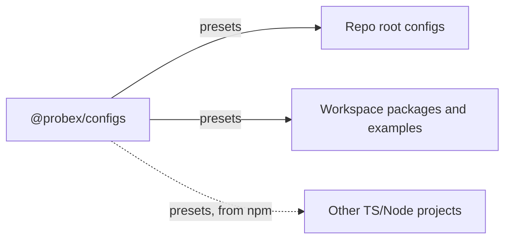

# Configs

## Purpose

`@probex/configs` holds shared presets for development tools (TypeScript, ESLint, Prettier and Vitest), so every
consumer configures them the same way instead of copying config. Today the consumers are the root, `packages/*` and
`examples/*` of this monorepo. The presets are general and contain nothing specific to ProbeX, so the package can
also serve any TS/Node project that installs it from npm.

## Boundaries

- Owns: general presets per tool (`tsconfig/base.json`, `tsconfig/workspace.json`, `eslint`, `prettier`, `vitest`)
  and the ESLint plugins they need, bundled as dependencies.
- Does not own: repo-level orchestration and gates, such as the Vitest projects list, the coverage thresholds and the
  root `tsconfig.json` include list. Each repo keeps them in its own root config. It also does not own repo
  conventions such as the `@probex/source` condition name, which the consumer passes in.
- Constraints:
  - Dev-time only: never a runtime dependency of the SDK or the host app.
  - Depends on no other ProbeX package.
  - `typescript`, `eslint`, `prettier` and `vitest` are optional peer dependencies, so a consumer installs only the
    tools it uses.
  - A tool gets a preset once its config is shared by two or more consumers, inside or outside the monorepo.

## Interactions

Consumers apply a preset in their own config file and add their overrides on top.
Signatures and examples: [`docs/api/configs.md`](../api/configs.md).

| Preset                    | Applied with                                                     |
| ------------------------- | ---------------------------------------------------------------- |
| `tsconfig/base.json`      | `"extends"` in `tsconfig.json`                                   |
| `tsconfig/workspace.json` | `"extends"` in a package's `tsconfig.json`                       |
| `eslint`                  | spread into the flat config array                                |
| `prettier`                | re-exported from `prettier.config.js`                            |
| `vitest`                  | `createVitestConfig()` or the default export in a project config |

## Key flows

### Running tests against sources

1. A workspace package exports the `@probex/source` condition pointing at `src/index.ts`.
2. Its `vitest.config.ts` calls `createVitestConfig({ sourceCondition: "@probex/source" })`.
3. Vitest resolves imports of workspace packages to their sources, so tests run without a build. A package without
   the condition resolves through its default export as usual.

### Changing a preset

1. A lint or format rule changes through `/code-style`. Any other preset change goes through a regular PR.
2. The same PR changes the preset and fixes every consumer in the monorepo, which takes it through `workspace:*`.
   `pnpm verify` must pass.
3. A setting that only one repo needs goes into that repo's own config, not into the preset.

## Decisions

- Presets are plain JavaScript with hand-written `.d.ts` files, and JSON for `tsconfig`. Tools load them directly,
  so lint, tests and typecheck need no build step, and the package works the same from the workspace and from npm.
- The source condition is a parameter of the Vitest preset, so no ProbeX name is baked into a published preset.
