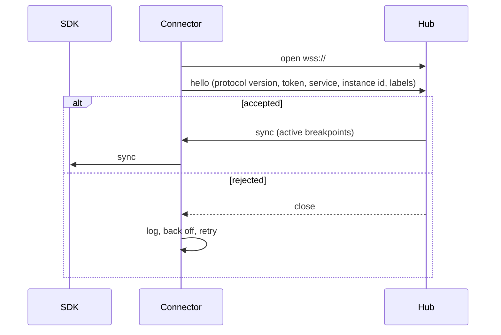

# Connector

## Purpose

`@probex/connector` is the default `Connector`: it carries protocol messages between the SDK and the hub over one
outbound WebSocket, from inside the host app.

## Boundaries

- Owns: the connection to the hub, authentication, reconnects, the bounded send queue.
- Does not own: configuration, breakpoints or snapshot content (the [SDK](sdk.md)), message types
  (`@probex/shared`).
- Gets every input as parameters from the SDK; reads no environment variables and no files.
- Implements the `Connector` interface from `@probex/shared`; a custom connector replaces it as a whole.
- Opens no ports in the host app and has no runtime dependencies: it uses the global `WebSocket` of Node.js.
- Never throws into the host app: every failure is logged and the connector stays inert.

## Interactions

## Key flows

### Connect

1. The connector gets the hub address, token and instance identity as parameters from the SDK.
2. It opens `wss://` to the hub. Plain `ws://` is allowed only to `localhost`. The connector verifies the hub's
   TLS certificate, optionally against a custom CA.
3. It sends `hello`: protocol version, token, service name, instance id and labels. The token is never put in the
   URL and never logged.
4. If the hub rejects it, the connector logs the reason, backs off with jitter and retries; the SDK stays inert.
5. If the hub accepts it, the hub sends `sync` and the connector passes it to the SDK. This runs on the first
   connect and on every reconnect.

### Send

The connector keeps outgoing messages in a bounded in-memory queue and sends them asynchronously. It sends the next
message only while the socket's `bufferedAmount` is under a limit, so unsent data never piles up outside the queue.
When the queue is full, the oldest message is dropped. A message is deleted from memory once it is sent.

### Disconnect

1. The connector reports the disconnect to the SDK, which removes all breakpoints.
2. It drops every unsent message.
3. It reconnects with exponential backoff and random jitter, so a hub restart does not bring every instance back
   at the same moment, and runs Connect again. The global `WebSocket` does not reconnect on its own; this is the
   connector's job.

## Decisions

- [ADR 0001](../adr/0001-use-websocket-for-connector-to-hub-transport.md) — WebSocket between connector and hub.
- [ADR 0002](../adr/0002-authenticate-connectors-with-per-service-api-tokens.md) — per-service API tokens.
