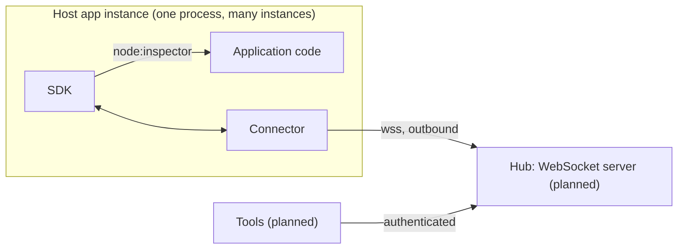

# Architecture overview

## Components

- **SDK** runs inside the host app. It sets breakpoints in V8 through `node:inspector`, captures snapshots and
  keeps the host app safe. See [SDK](sdk.md).
- **Connector** runs inside the host app next to the SDK. It is a WebSocket client of the hub and carries protocol
  messages between the SDK and the hub. See [Connector](connector.md).
- **Hub** is a planned separate service: a WebSocket server that the connectors of every instance connect to. It is
  the source of truth for active breakpoints.
- **Tools** are planned programs that manage breakpoints and read snapshots. They authenticate to the hub and talk
  only to it, never to host apps.

A **breakpoint** is a command: a location plus its settings. A **snapshot** is the data V8 returns when a
breakpoint is hit: call stack, scopes and variables.

The host app opens no ports.

## Packages

| Package               | Runs in  | Holds                                                                                    | Depends on        |
| --------------------- | -------- | ---------------------------------------------------------------------------------------- | ----------------- |
| `packages/configs`    | dev only | shared tsconfig, ESLint, Prettier, Vitest presets                                        | -                 |
| `packages/shared`     | -        | public types: `Connector`, protocol messages, `Breakpoint`, `Snapshot`, protocol version | -                 |
| `packages/connector`  | host app | default connector over WebSocket                                                         | shared            |
| `packages/sdk`        | host app | debugger core; uses the default connector unless one is given                            | shared, connector |
| `examples/node-basic` | demo     | demo app                                                                                 | sdk               |

The SDK is the only part that reads configuration: options passed in code and environment variables, with code
winning over environment. It reads `process.env` only; loading `.env` files is the host app's job. With the hub
address and token in the environment, the SDK needs no options in code.

The SDK creates the default connector from `@probex/connector` and passes it every input as parameters: hub
address, token, service name, instance id and labels. The connector reads no environment variables and no files.
Any object that implements the `Connector` interface from `@probex/shared` can replace it through the SDK
configuration; the host app then configures that connector itself.

## Key flows

1. **Connect.** The connector opens `wss://` to the hub and sends `hello`. The hub answers with `sync`, the full
   list of active breakpoints for this instance, and the SDK applies it. See [Connector](connector.md).
2. **Set and remove a breakpoint.** The hub sends the command, the SDK applies it in V8 and reports its status
   back. See [SDK](sdk.md).
3. **Capture a snapshot.** V8 pauses, the SDK checks the rate limit, captures within budgets, resumes and hands the
   snapshot to the connector. See [SDK](sdk.md).
4. **Disconnect.** The SDK removes all breakpoints and the connector drops unsent snapshots: when breakpoints cannot
   be confirmed current, ProbeX does no work. The connector reconnects and runs Connect again. See
   [Connector](connector.md).

## Decisions

- [ADR 0001](../adr/0001-use-websocket-for-connector-to-hub-transport.md) — WebSocket between connector and hub.
- [ADR 0002](../adr/0002-authenticate-connectors-with-per-service-api-tokens.md) — per-service API tokens.
- [ADR 0003](../adr/0003-use-a-message-level-interface-for-connectors.md) — message-level `Connector` interface.
- [ADR 0004](../adr/0004-represent-snapshot-variables-as-a-nested-tree.md) — snapshot variables as a nested tree.
