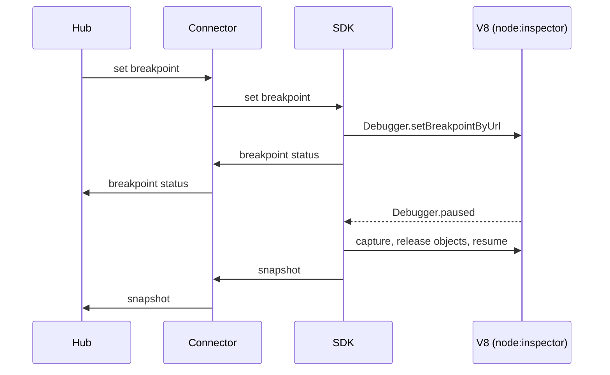

# SDK

## Purpose

`@probex/sdk` is the debugger core inside the host app. It applies breakpoints in V8 through `node:inspector`,
captures snapshots when they are hit and guarantees that ProbeX never crashes, throws into or blocks the host app.

## Boundaries

- Owns: configuration, breakpoints in V8, snapshot capture, rate limits and capture budgets, redaction of
  secrets, the safety of the host app.
- Reads configuration from options in code and from `process.env`; code wins over environment. It does not load
  `.env` files. The configuration holds the maxima that cap the limits of every breakpoint and the name patterns
  to redact.
- Creates the default connector and passes it every input as parameters: hub address, token, service name,
  instance id and labels.
- Does not own: transport, authentication, reconnects, the send queue (all in the [connector](connector.md)), or
  which breakpoints are active (the hub decides).
- Knows nothing about other instances of the app.
- Uses the default connector from `@probex/connector` unless the SDK configuration gives another `Connector`,
  which the host app configures itself.

## Interactions

## Key flows

### Apply `sync`

The SDK reconciles its breakpoints with the full list in `sync`: it sets the missing ones, removes the ones not
listed and updates the changed ones.

### Set and remove a breakpoint

1. The SDK maps the source location to the running JS through the script's source map, when there is one;
   otherwise it uses the location as is.
2. It sets the breakpoint with `Debugger.setBreakpointByUrl`.
3. It reports the status back through the connector: `set`, `pending` until the file is loaded, `failed` or
   `location-not-found`.
4. Removal uses `Debugger.removeBreakpoint` the same way.

### Capture a snapshot

1. V8 pauses the thread on a breakpoint hit.
2. The SDK checks the breakpoint's rate limit. If it is exhausted, the SDK resumes at once and captures nothing.
3. If the breakpoint has a condition, the SDK evaluates it with `throwOnSideEffect`, so code that changes state or
   does I/O fails instead of running. False or failed → resume without capture; a failure is reported in
   `breakpointStatus`.
4. The SDK captures the call stack and, for the frames and scopes the breakpoint selects, the variables as a
   nested tree, within the breakpoint's limits capped by the configured maxima.
5. It evaluates the watches with the same `throwOnSideEffect` rule.
6. It replaces the values of variables whose names match the redaction patterns, so secrets never leave the host
   app.
7. It releases the V8 object references it used and resumes, also when capture fails.
8. It hands the snapshot to the connector, which sends it asynchronously. Nothing is written to disk.

### Disconnect

When the connector reports a disconnect, the SDK removes all breakpoints. They come back with the next `sync`.

## Decisions

- [ADR 0003](../adr/0003-use-a-message-level-interface-for-connectors.md) — message-level `Connector` interface.
- [ADR 0004](../adr/0004-represent-snapshot-variables-as-a-nested-tree.md) — variables as a nested tree.
