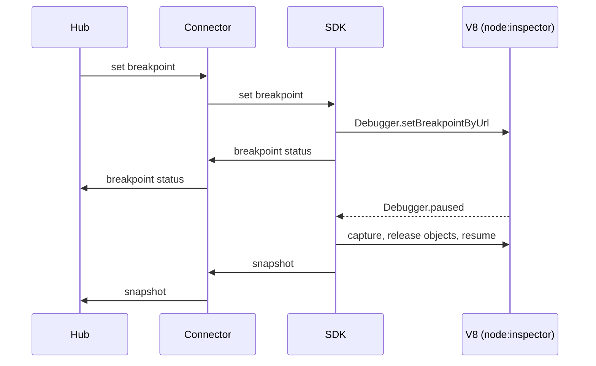

# SDK

## Purpose

`@probex/sdk` is the debugger core inside the host app. It applies breakpoints in V8 through `node:inspector`,
captures snapshots when they are hit and guarantees that ProbeX never crashes, throws into or blocks the host app.

## Boundaries

- Owns: configuration, breakpoints in V8, snapshot capture, rate limits and capture budgets, the safety of the
  host app.
- Reads configuration from options in code and from `process.env`; code wins over environment. It does not load
  `.env` files.
- Creates the default connector and passes it every input as parameters: hub address, token, service name,
  instance id and labels.
- Does not own: transport, authentication, reconnects, the send queue (all in the [connector](connector.md)), or
  which breakpoints are active (the hub decides).
- Knows nothing about other instances of the app.
- Uses the default connector from `@probex/connector` unless the SDK configuration gives another `Connector`,
  which the host app configures itself.

## Interactions

## Key flows

### Apply `sync`

The SDK reconciles its breakpoints with the full list in `sync`: it sets the missing ones, removes the ones not
listed and updates the changed ones.

### Set and remove a breakpoint

1. The SDK sets the breakpoint with `Debugger.setBreakpointByUrl`.
2. It reports the status back through the connector: set, failed or location not found.
3. Removal uses `Debugger.removeBreakpoint` the same way.

### Capture a snapshot

1. V8 pauses the thread on a breakpoint hit.
2. The SDK checks the breakpoint's rate limit. If it is exhausted, the SDK resumes at once and captures nothing.
3. The SDK captures the call stack, scopes and variables within depth, size and time budgets.
4. The SDK releases the V8 object references it used and resumes, also when capture fails.
5. The SDK hands the snapshot to the connector, which sends it asynchronously. Nothing is written to disk.

### Disconnect

When the connector reports a disconnect, the SDK removes all breakpoints. They come back with the next `sync`.

## Decisions

None yet.
