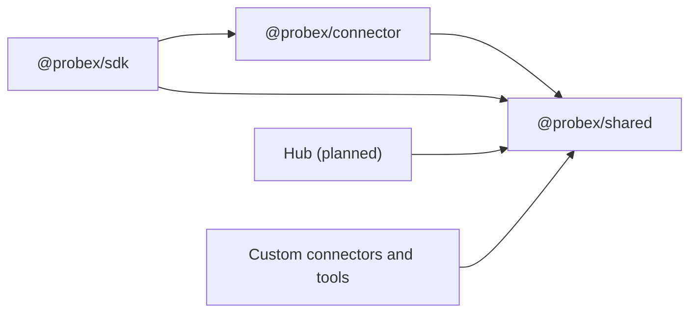

# Shared

## Purpose

`@probex/shared` is the public contract of ProbeX: the `Connector` interface, the protocol messages, the
`Breakpoint` and `Snapshot` types and the protocol version. The SDK, the connector and the hub use it, and so do
end users who write their own connector or read snapshots. It is TypeScript only; its types are the full protocol
spec.

## Boundaries

- Holds what two or more packages use and every public type end users need. Anything else lives in its package.
- Types and constants only: no runtime logic, no validators, no side effects, no dependencies. Receivers validate
  incoming messages themselves; the connector does it with hand-written type guards.
- Messages are JSON: every value survives `JSON.stringify` → `JSON.parse` unchanged.
- Every message carries the protocol version, one integer bumped only on a breaking change. A non-breaking change
  only adds optional fields; receivers ignore fields they do not know.

## Interactions

## Key flows

### Connector interface

A connector moves messages and knows nothing about their content. It is started and stopped by the SDK, sends
messages from the SDK, delivers messages to the SDK and reports connection state changes (connected,
disconnected). A new command is a new message type; the interface itself does not change. See
[ADR 0003](../adr/0003-use-a-message-level-interface-for-connectors.md).

### Messages

Every message has a `type` and the protocol version.

| Message            | Direction       | Carries                                                    |
| ------------------ | --------------- | ---------------------------------------------------------- |
| `hello`            | connector → hub | protocol version, token, service name, instance id, labels |
| `reject`           | hub → connector | the reason: unsupported protocol version, invalid token    |
| `sync`             | hub → SDK       | the full list of active breakpoints for this instance      |
| `setBreakpoint`    | hub → SDK       | one breakpoint to add or update                            |
| `removeBreakpoint` | hub → SDK       | the breakpoint id                                          |
| `breakpointStatus` | SDK → hub       | breakpoint id, state, optional error                       |
| `snapshot`         | SDK → hub       | one snapshot                                               |

`hello` and `reject` stay between the connector and the hub. When the protocol versions differ, the hub sends
`reject` and closes the connection.

### Breakpoint

| Field       | Meaning                                                                                     |
| ----------- | ------------------------------------------------------------------------------------------- |
| `id`        | set by the hub                                                                              |
| `location`  | source file matched by path suffix (`src/orders/service.ts`), 1-based line, optional column |
| `condition` | optional expression; a snapshot is captured only when it is true                            |
| `watches`   | optional expressions evaluated at the hit; each result or error goes into the snapshot      |
| `capture`   | optional: which scopes to capture and how many frames get variables                         |
| `limits`    | optional: depth, string length, collection items, snapshot size, time budget, rate limit    |

By default every frame gets variables and every scope is captured except Global. The SDK caps `limits` with the
maxima from its configuration. A breakpoint lives until the hub removes it or the instance disconnects.

`breakpointStatus` reports the state `set`, `pending` (the file is not loaded yet), `failed` or
`location-not-found`, with an error message when there is one, such as a failed condition.

### Snapshot

A snapshot mirrors what a debugger shows at a pause:

- the breakpoint id and the capture time (ISO 8601);
- the call stack: for each frame the function name and the source-mapped file, line and column;
- for each frame with variables, its scopes (Local, Closure, Block, `this`, Global, …), each a list of variables;
- the watch results;
- a `truncated` flag when a budget ran out before capture finished.

Each variable has a name, a type, an optional value preview and optional children, which makes a nested tree. A
variable is marked `truncated` when a limit cut it short, `circular` when it points back to an ancestor and
`redacted` when the SDK removed its value. See
[ADR 0004](../adr/0004-represent-snapshot-variables-as-a-nested-tree.md).

## Decisions

- [ADR 0001](../adr/0001-use-websocket-for-connector-to-hub-transport.md) — messages are JSON over WebSocket.
- [ADR 0003](../adr/0003-use-a-message-level-interface-for-connectors.md) — message-level `Connector` interface.
- [ADR 0004](../adr/0004-represent-snapshot-variables-as-a-nested-tree.md) — variables as a nested tree.
