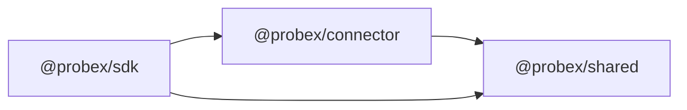

# Shared

## Purpose

`@probex/shared` holds the contract between the SDK and the connector: the `Connector` interface, the protocol
messages exchanged with the hub and the protocol version.

## Boundaries

- Types and constants only: no runtime logic, no side effects, no dependencies.
- Messages are JSON: every value survives `JSON.stringify` → `JSON.parse` unchanged.
- Every message carries the protocol version. Changes are backward-compatible or bump the version.

## Interactions

## Key flows

None yet.

## Decisions

- [ADR 0001](../adr/0001-use-websocket-for-connector-to-hub-transport.md) — messages are JSON over WebSocket.
